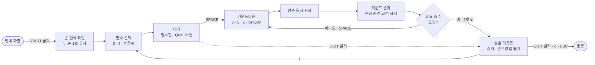

<div align="center">

# 🖐️ HandClash

### 웹캠 손 제스처 대전 가위바위보

웹캠 한 대로 두 사람이 동시에 손을 내밀어 겨루고,<br>
대결이 끝나면 **손모양별 승률 리포트**를 보여주는 프로그램입니다.

[](https://www.python.org/)
[](https://developers.google.com/mediapipe)
[](https://opencv.org/)
[](LICENSE)

</div>

---

## ✨ 이런 게임이에요

- 🎮 **사람 대 사람** — 한 화면을 좌우로 나눠 P1·P2가 각자 손을 내밀어요
- ✋ **실시간 판정** — MediaPipe로 양손을 동시에 인식해 가위·바위·보를 가려요
- 📊 **습관 리포트** — 손모양별로 몇 번 냈고 몇 번 이겼는지 승률로 보여줘요

## 🧩 주요 기능

| 기능 | 설명 | 담당 |
|:----:|------|:----:|
| `hand_tracker.py` | MediaPipe 양손 인식, 화면 좌/우로 P1·P2 구분 | 최성민 |
| `finger_state.py` | 손가락 펴짐 배열로 가위·바위·보 판정 | 김화섭 |
| `game.py` | 라운드 승패 판정, 판수(3·5·7) 진행, 중간 종료 시 누적 점수로 승자 판별 | 최성민 |
| `records.py` | 대결 기록 CSV 저장, 손모양별 횟수·승률 리포트, 통계 그래프(PNG) 저장 | 서진서 |
| `ui.py` | 안내·손 인식 확인·판수 선택 화면, 카운트다운, 좌우 분할 화면, 점수판, 라운드 결과, 승률 리포트 화면 | 김나영 |
| `main.py` | 위 기능을 한 흐름으로 연결하는 실행 파일 | 최성민 |

## 🔄 게임 진행 흐름



- 한 사람의 손이라도 인식되지 않으면 `Show both hands!`가 표시되고, 점수 변화 없이 같은 라운드를 다시 진행합니다(`SPACE try again`).
- 게임 중 **QUIT** 버튼을 누르면 그 시점의 누적 점수로 승자를 정합니다(동점이면 무승부).

## 🚀 설치와 실행

Python 3.12 이상이 필요하고, 웹캠이 연결되어 있어야 합니다.

<!-- 테스트한 Python 버전을 실제로 확인한 뒤 위 줄에 적어 주세요 (예: 3.13에서 테스트). -->

```bash
# 1) 저장소 받기
git clone https://github.com/khseob2/RPS.git
cd RPS

# 2) 라이브러리 설치 (mediapipe, opencv-python, numpy, matplotlib)
pip install -r requirements.txt

# 3) 실행
python main.py
```

## 🕹️ 사용법

1. `python main.py`를 실행하면 안내 화면이 열립니다. 화면은 가운데 선을 기준으로 나뉘며, 화면 왼쪽에 낸 손은 **P1**, 오른쪽에 낸 손은 **P2**로 인식합니다.
2. 안내 화면의 **START** 버튼을 클릭합니다.
3. **손 인식 확인** 화면에서 두 사람이 각자 자기 영역에 손을 올립니다.
   - 손이 잡힌 쪽은 `P1 READY`, 안 잡힌 쪽은 `Show your hand in the P1 area`가 표시됩니다.
   - 두 손이 **1초 동안** 계속 인식되면 판수 선택 화면으로 넘어갑니다.
   - 화면 아래에서 인정되는 손 모양(Rock · Scissors · Paper) 예시를 볼 수 있습니다.
4. 판수 버튼(**3 / 5 / 7**)을 클릭해 판수를 고릅니다. 3판은 2선승, 5판은 3선승, 7판은 4선승입니다.
5. **스페이스바**를 누르면 라운드가 시작됩니다. `3 → 2 → 1 → SHOW!` 카운트다운이 끝나는 순간 두 사람의 손 모양을 동시에 판정합니다.
6. 판정 순간의 화면이 멈춘 채로 두 사람의 손 모양과 결과(`P1 WIN` / `P2 WIN` / `DRAW`)가 표시되고, 화면 아래 점수판이 갱신됩니다.
   - 결과는 **스페이스바**를 누를 때까지 유지되며, 누르면 바로 다음 라운드 카운트다운이 시작됩니다(`SPACE next round`).
   - 한 사람의 손이라도 인식되지 않으면 `Show both hands!`가 표시되고, 점수 변화 없이 같은 라운드를 다시 진행합니다(`SPACE try again`).
7. 먼저 필요한 승수를 채운 사람이 나오면 마지막 결과를 2초 보여 준 뒤 **승률 리포트** 화면으로 넘어갑니다.
   - 리포트 화면에는 승자, 최종 점수, P1·P2별 손모양 통계(낸 횟수 / 이긴 횟수 / 승률)가 표시됩니다.
   - **G**를 누르면 표 → 낸 횟수 → 이긴 횟수 → 승률 그래프 순서로 넘겨 볼 수 있습니다.
8. 게임 중 화면 오른쪽 위의 **QUIT** 버튼을 클릭하면 그 시점의 누적 점수로 승자를 정하고(동점이면 무승부) 리포트 화면으로 넘어갑니다.
9. 리포트 화면에서 **r**을 누르면 판수 선택 화면으로 돌아가 다시 시작하고, **QUIT** 버튼을 클릭하거나 **q** / **ESC**를 누르면 프로그램이 종료됩니다.

### 조작 방법

| 입력 | 동작 |
|:---:|------|
| **START** 클릭 | 안내 화면 → 손 인식 확인 화면 |
| 두 손 1초 유지 | 손 인식 확인 화면 → 판수 선택 화면 |
| **3 / 5 / 7** 클릭 | 판수를 정하고 대결 화면으로 이동 |
| `SPACE` | 라운드 시작 (카운트다운), 결과 화면에서 다음 라운드 시작 |
| **QUIT** 클릭 (게임 중) | 게임 중간 종료, 누적 점수로 승자 결정 후 리포트 화면 |
| **QUIT** 클릭 (리포트 화면) | 프로그램 종료 |
| `r` | 판수 선택 화면으로 돌아가 다시 시작 |
| `q` / `ESC` | 프로그램 종료 (언제든 동작) |
| `g` (리포트 화면) | 표와 그래프 3장을 차례로 넘겨 보기 |

### 손 모양 인식 기준

검지·중지·약지·새끼손가락의 펴짐 여부로 판정합니다. 엄지는 판정에 쓰지 않습니다.

| 손 모양 | 손가락 상태 |
|:---:|------|
| 바위 | 네 손가락을 모두 접음 |
| 가위 | 검지와 중지만 폄 |
| 보 | 네 손가락을 모두 폄 |

### 기록과 리포트

- 판정된 라운드는 `data/records.csv`에 한 줄씩 저장됩니다(`game_id`, `round`, `p1_hand`, `p2_hand`, `result`). 손이 인식되지 않은 라운드는 저장하지 않습니다.
- 기록은 프로그램을 실행할 때마다 새로 시작하며, 한 번 실행하는 동안 여러 게임을 하면 기록이 이어서 쌓입니다. 리포트 화면의 통계도 이 기록을 기준으로 합니다.
- 리포트 화면에 들어가면 `data/` 폴더에 통계 그래프 3장이 저장되고 화면에서 바로 볼 수 있습니다. 프로그램을 종료하면 터미널에 플레이어별 리포트가 출력됩니다.

| 파일 | 내용 |
|------|------|
| `data/hand_graph.png` | 손모양별 낸 횟수 (P1 · P2) |
| `data/wins_graph.png` | 손모양별 이긴 횟수 (P1 · P2) |
| `data/win_rate_graph.png` | 손모양별 승률 (P1 · P2) |

`data/` 폴더의 기록·그래프 파일은 실행할 때마다 만들어지므로 Git에 올리지 않습니다(`.gitignore`).

## 👥 팀원

**팀명: RPS**

| 김화섭 | 최성민 | 서진서 | 김나영 |
| :---: | :---: | :---: | :---: |
|  |  |  |  |
| 팀장 | 개발 리드 | 문서 담당 | 리뷰·품질 담당 |
| [@khseob2](https://github.com/khseob2) | [@J0RMUN64ND](https://github.com/J0RMUN64ND) | [@seojinseo123](https://github.com/seojinseo123) | [@doranayoung](https://github.com/doranayoung) |

## 📄 라이선스

MIT License — see [LICENSE](LICENSE)
