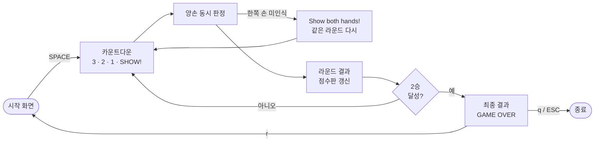

<div align="center">

# 🖐️ HandClash

### 웹캠 손 제스처 대전 가위바위보

웹캠 한 대로 두 사람이 동시에 손을 내밀어 겨루고,<br>
대결이 끝나면 **손모양별 승률 리포트**를 보여주는 프로그램입니다.

[](https://www.python.org/)
[](https://developers.google.com/mediapipe)
[](https://opencv.org/)
[](LICENSE)

</div>

---

## ✨ 이런 게임이에요

- 🎮 **사람 대 사람** — 한 화면을 좌우로 나눠 P1·P2가 각자 손을 내밀어요
- ✋ **실시간 판정** — MediaPipe로 양손을 동시에 인식해 가위·바위·보를 가려요
- 📊 **습관 리포트** — 손모양별로 몇 번 냈고 몇 번 이겼는지 승률로 보여줘요

## 🧩 주요 기능

| 기능 | 설명 | 담당 |
|:----:|------|:----:|
| `hand_tracker.py` | MediaPipe 양손 인식, 화면 좌/우로 P1·P2 구분 | 최성민 |
| `finger_state.py` | 손가락 펴짐 배열로 가위·바위·보 판정 | 김화섭 |
| `game.py` | 라운드 승패 판정, 판수(3·5·7) 진행, 중간 종료 시 누적 점수로 승자 판별 | 최성민 |
| `records.py` | 대결 기록 CSV 저장, 손모양별 횟수·승률 리포트 | 서진서 |
| `ui.py` | 카운트다운, 좌우 분할 화면, 라운드 결과·점수판·최종 결과 화면, 판수·종료 버튼 | 김나영 |
| `main.py` | 위 기능을 한 흐름으로 연결하는 실행 파일 | 최성민 |

## 🔄 게임 진행 흐름

현재 버전(중간발표 시점)의 흐름입니다. 판수는 3판 2선승으로 고정되어 있습니다.



## 🚀 설치와 실행

Python 3.12 이상이 필요하고, 웹캠이 연결되어 있어야 합니다.

<!-- 테스트한 Python 버전을 실제로 확인한 뒤 위 줄에 적어 주세요 (예: 3.13에서 테스트). -->

```bash
# 1) 저장소 받기
git clone https://github.com/khseob2/RPS.git
cd RPS

# 2) 라이브러리 설치
pip install -r requirements.txt

# 3) 실행
python main.py
```

## 🕹️ 사용법

1. `python main.py`를 실행하면 웹캠 화면이 가운데 선을 기준으로 좌우로 나뉘어 열립니다. 화면 왼쪽에 낸 손은 **P1**, 오른쪽에 낸 손은 **P2**로 인식합니다.
2. 화면에 `Press SPACE to start`가 보이면 **스페이스바**를 눌러 대결을 시작합니다. 판수는 **3판 2선승**입니다.
3. `3 → 2 → 1 → SHOW!` 카운트다운이 끝나는 순간 두 사람의 손 모양을 동시에 판정합니다.
4. 화면 가운데에 두 사람의 손 모양과 결과(`P1 WIN` / `P2 WIN` / `DRAW`)가 2초 동안 표시되고, 화면 아래 점수판이 갱신됩니다. 이후 다음 라운드 카운트다운이 자동으로 시작됩니다.
   - 한 사람의 손이라도 인식되지 않으면 `Show both hands!`가 표시되고, 점수 변화 없이 같은 라운드를 다시 진행합니다.
5. 먼저 2승을 한 사람이 나오면 `GAME OVER` 화면에 최종 승자와 점수가 표시됩니다.
6. 최종 결과 화면에서 **r**을 누르면 처음부터 다시 시작하고, **q** 또는 **ESC**를 누르면 프로그램이 종료됩니다. (q와 ESC는 게임 중 언제든 동작합니다.)

### 키 조작

| 키 | 동작 |
|:---:|------|
| `SPACE` | 시작 화면에서 대결 시작 |
| `r` | 최종 결과 화면에서 다시 시작 |
| `q` / `ESC` | 프로그램 종료 |

### 손 모양 인식 기준

검지·중지·약지·새끼손가락의 펴짐 여부로 판정합니다. 엄지는 판정에 쓰지 않습니다.

| 손 모양 | 손가락 상태 |
|:---:|------|
| 바위 | 네 손가락을 모두 접음 |
| 가위 | 검지와 중지만 폄 |
| 보 | 네 손가락을 모두 폄 |

### 개발 예정 기능

아래 기능은 `ui.py`·`game.py`·`records.py`에 구현되어 있으며, `main.py`에 연결하는 작업을 진행하고 있습니다.

- 시작 안내 화면과 **START** 버튼
- 판수 선택 버튼(**3 / 5 / 7**)
- 게임 중 **QUIT** 버튼으로 중간 종료 (그 시점 누적 점수로 승자 판별, 동점이면 무승부)
- 대결 기록 CSV 저장과 손모양별 횟수·승률 **리포트 화면**

## 👥 팀원

**팀명: RPS**

| 김화섭 | 최성민 | 서진서 | 김나영 |
| :---: | :---: | :---: | :---: |
|  |  |  |  |
| 팀장 | 개발 리드 | 문서 담당 | 리뷰·품질 담당 |
| [@khseob2](https://github.com/khseob2) | [@J0RMUN64ND](https://github.com/J0RMUN64ND) | [@seojinseo123](https://github.com/seojinseo123) | [@doranayoung](https://github.com/doranayoung) |

## 📄 라이선스

MIT License — see [LICENSE](LICENSE)
